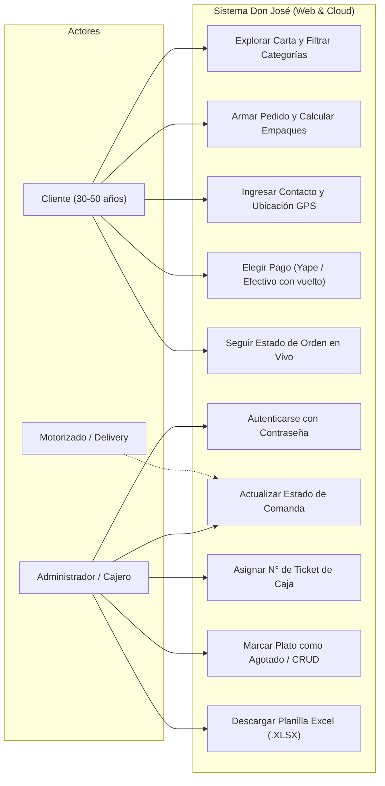
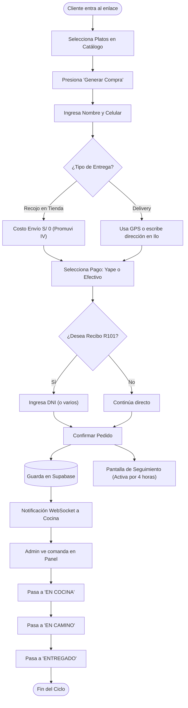
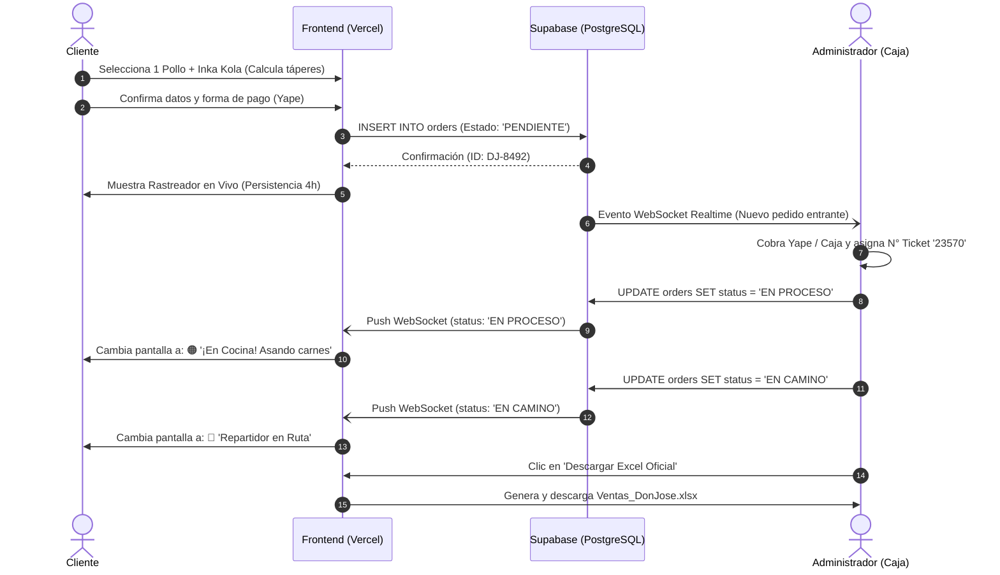
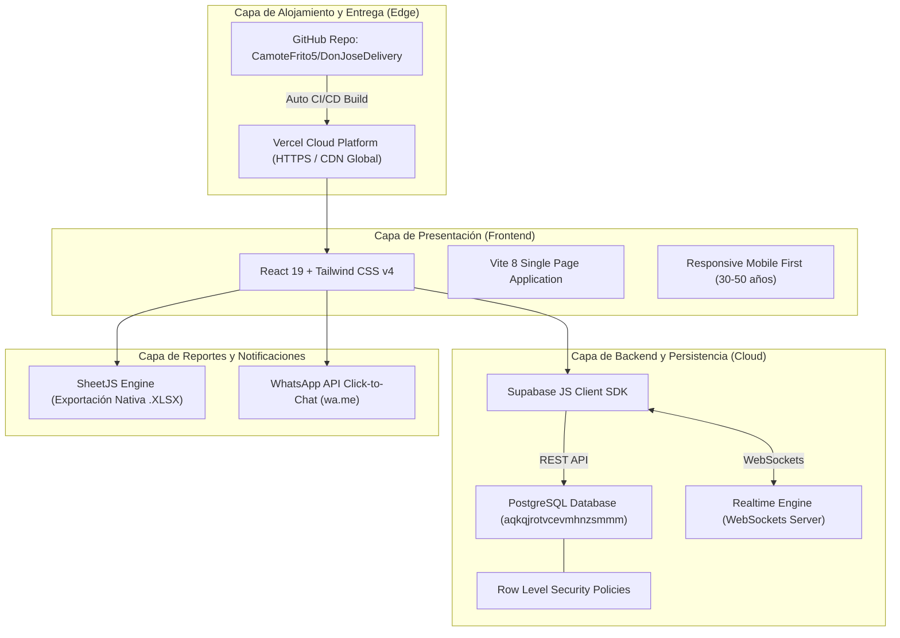
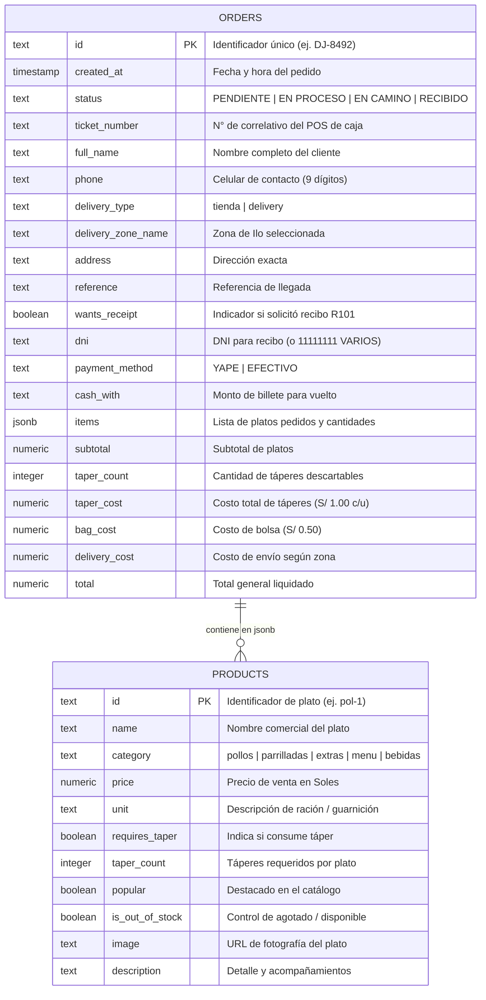

# INFORME TÉCNICO Y ESPECIFICACIÓN DE SOFTWARE (SRS)
## Sistema de Catálogo Digital, Pedidos y Gestión Operativa
### **Restaurant Parrilladas y Pollería DON JOSÉ (Ilo, Moquegua)**

**Asignatura:** IS-621 Ingeniería de Software  
**Institución:** Universidad Nacional de Moquegua (UNAM)  
**Fecha de consolidación:** Octubre 2026  
**Repositorio GitHub:** `https://github.com/CamoteFrito5/DonJoseDelivery`  
**Despliegue Cloud:** Vercel + Supabase (PostgreSQL Realtime)

---

## 1. Contexto Empresarial y Diagnóstico Operativo

### 1.1. Información General del Negocio
* **Nombre Comercial:** Restaurant Parrilladas y Pollería DON JOSÉ
* **Titular / Razón Social:** CCARITA HILAHUANCCO JOSE
* **Ubicación:** A.H. PROMUVI IV Nuevo Ilo, Mz. 35 Lote 20, Ilo, Moquegua
* **Infraestructura:** Inmueble de 3 plantas que opera como vivienda y establecimiento comercial, con más de 20 años de trayectoria en la localidad.
* **Canales Telefónicos Oficiales:** 953 953 533 / 959 578 182 / (053) 495844.
* **Sistema Actual de Facturación:** Software SaaS externo (*PeFactura*, con costo de mantenimiento de S/ 90 mensuales). No cuenta con API abierta ni acceso a código fuente.

### 1.2. Problemática Central Identificada
1. **Cuello de Botella en Hora Punta:** Los pedidos entraban principalmente vía WhatsApp y llamadas telefónicas en momentos de máxima afluencia (almuerzos y cenas), coincidiendo con la atención en caja física por parte del administrador.
2. **Llamadas Prolongadas e Ineficiencia (Hasta 8 Minutos):** Clientes del rango demográfico de **30 a 50 años** solían llamar con indecisión sobre la carta, consultando precios plato por plato o negociando descuentos, consumiendo valioso tiempo operativo.
3. **Complejidad Logística en Entregas:** Falta de claridad previa sobre el cobro de empaques (táperes y bolsas) y confusión en las modalidades de delivery (pago anticipado por Yape vs repartidores independientes que adelantan el pago en caja).

---

## 2. Requerimientos del Sistema (IEEE 830 Adaptado)

### 2.1. Requisitos Funcionales (RF)
* **RF-01 (Catálogo Interactivo):** El sistema debe presentar la carta clasificada por categorías (Pollos, Parrilladas, Platos Extras, Menú, Fines de Semana, Bebidas y Guarniciones) con precios oficiales y control de cantidad (+/-) intuitivo.
* **RF-02 (Gestión de Empaques Automática):** El sistema debe computar automáticamente el coste de táperes térmicos (S/ 1.00 por plato) y bolsa de despacho (S/ 0.50), mostrándolo desglosado en el resumen.
* **RF-03 (Registro Ágil de Contacto):** El formulario de contacto solo debe exigir Nombre Completo y Teléfono celular (9 dígitos), eliminando registros con contraseñas complejas.
* **RF-04 (Modalidad y Geolocalización GPS):** Permitir seleccionar entre *Recojo en Local* (gratis) y *Delivery*. Para delivery, debe ofrecer un botón con la API de Geolocalización del navegador (`navigator.geolocation`) para capturar la ubicación con un toque.
* **RF-05 (Recibo y DNI Opcionales):** La emisión de la Nota de Pedido digital y el ingreso de DNI son 100% opcionales. Si se activa, se genera un ticket digital con serie correlativa `R101-XXXXXXXX`.
* **RF-06 (Métodos de Pago Flexibles):** Soportar **Yape** (mostrando número de titular `953 953 533` y botón copiar) y **Efectivo Contra Entrega** (con cálculo de vuelto exacto).
* **RF-07 (Seguimiento de Orden en Vivo sin salir a WhatsApp):** El cliente debe visualizar el progreso de su pedido en tiempo real (*1. Pendiente*, *2. En Cocina*, *3. En Camino*, *4. Entregado*).
* **RF-08 (Persistencia de Sesión de 4 Horas):** El pedido activo debe mantenerse visible en la pantalla del cliente ante recargas (`F5`) o cierre del navegador durante una ventana de 4 horas.
* **RF-09 (Panel Administrativo Protegido):** Acceso seguro mediante contraseña (`ParrilladaDonJose432%`) para que el administrador gestione estados y asigne el `N° de tiket`.
* **RF-10 (Gestión de Stock / Ocultar Agotados):** El administrador debe poder marcar cualquier plato como *"Agotado por hoy"*, agregar nuevos platos o editar precios desde el panel.
* **RF-11 (Exportación a Excel .XLSX):** Generación de la planilla diaria con las columnas exactas del negocio: `N° de tiket | N° | DESCRIPCION | MONTO | EFECTIVO/YAPE` y cuadre de caja.

### 2.2. Requisitos No Funcionales (RNF)
* **RNF-01 (Usabilidad Demográfica 30-50 años):** Botones táctiles de gran tamaño, tipografía con alto contraste y navegación guiada sin scroll infinito innecesario.
* **RNF-02 (Rendimiento):** Tiempo de carga inicial inferior a 1.5 segundos en redes móviles 3G/4G locales de Ilo.
* **RNF-03 (Seguridad):** Cifrado en tránsito HTTPS/TLS 1.3 provisto por Vercel. Políticas de seguridad a nivel de filas (RLS) en PostgreSQL.
* **RNF-04 (Tiempo Real / WebSockets):** Latencia de actualización de estado entre cocina y cliente menor a 100 milisegundos mediante Supabase Realtime.
* **RNF-05 (Compatibilidad):** Responsive design optimizado para navegadores Chrome, Safari y Edge en smartphones y PC.

---

## 3. Diagramas de Ingeniería de Software

### 3.1. Diagrama de Casos de Uso del Sistema

---

### 3.2. Diagrama de Flujo del Proceso Operativo (BPMN / Flowchart)

---

### 3.3. Diagrama de Secuencia (Interacción en Tiempo Real)

---

### 3.4. Diagrama de Arquitectura de Software

---

### 3.5. Modelo de Datos Entidad-Relación (ERD) en Supabase

---

## 4. Estructura de la Planilla Diaria de Ventas (Excel)

El sistema genera el reporte descargable en formato **Microsoft Excel (.XLSX)** con la estructura idéntica a la planilla física auditada del negocio:

| N° de tiket | N° | DESCRIPCION | MONTO | EFECTIVO/YAPE |
| :---: | :---: | :--- | :---: | :---: |
| 23550 | 1 | 1 POLLO A LA BRASA + 2 TAPER | S/ 70.50 | YAPE |
| 23551 | 2 | 2 MENU COMPLETO + 2 TAPER | S/ 26.50 | EFECTIVO |
| 23552 | 3 | PARRILLADA DON JOSE + INKAKOLA 1LT + 3 TAPER | S/ 116.50 | YAPE |

**Resumen de Cuadre de Caja al pie del archivo:**
* `TOTAL EN EFECTIVO:` Sumatoria de pedidos contra entrega y recojo.
* `TOTAL EN YAPE:` Sumatoria de transferencias al número `953 953 533`.
* `TOTAL GENERAL:` Ingreso bruto del día.

---

## 5. Parámetros de Despliegue y Configuración Cloud

* **Proveedor de Hosting:** Vercel Inc.
* **Proveedor de Base de Datos:** Supabase Cloud (PostgreSQL 15)
* **Project ID Supabase:** `aqkqjrotvcevmhnzsmmm`
* **Project URL:** `https://aqkqjrotvcevmhnzsmmm.supabase.co`
* **Contraseña del Administrador:** `ParrilladaDonJose432%`
* **Variables de Entorno en Producción:**
  * `VITE_SUPABASE_URL` = `https://aqkqjrotvcevmhnzsmmm.supabase.co`
  * `VITE_SUPABASE_ANON_KEY` = `eyJhbGciOiJIUzI1NiIsInR5cCI6IkpXVCJ9...`

---

## 6. Conclusión y Valor para la Ingeniería de Software
El proyecto transforma un proceso manual, propenso a retrasos de hasta 8 minutos por llamada telefónica y desorden en caja física, en una **arquitectura desacoplada, reactiva y de costo operativo cero**, respetando la cultura del negocio tradicional de Ilo y eliminando la barrera tecnológica para clientes mayores de 30 a 50 años.
